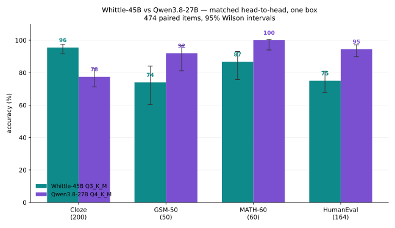

# First matched head-to-head: Whittle gives up 32 HumanEval items to buy 36 cloze items

*2026-10-30. One box, one build, one harness, four suites, 474 paired items per model. $0: garlic-clove (Intel Arc Pro B60, 21,414 MiB), `llama-q4e` build `035e227` (Vulkan, build 10443).*

## Why this exists

Whittle-45B is a distillation of Qwen3.8-27B, and the 28 Oct heal was distilled from it directly. Nobody had run the two against each other on the same bench, so every quality claim in the project's notes was inference from two disjoint benchmark sets. This closes that: byte-identical prompts, same sampler, same token caps, same answer extraction, same box.

Both models were served through the same `llama-server` binary, sequentially — 15.32 GiB of Qwen weights and 19.84 GiB of Whittle (plus a 5.6 GB table in host RAM) do not co-reside in 21.4 GiB of VRAM.

```
Whittle: w45_Q3_K_M.gguf, 21,310,673,216 B, sha256 9f034b43…b731 (hub HEAD, post-heal)
Qwen:    Qwen3.8-27B-UD-Q4_K_M.gguf, 16,464,440,224 B (unsloth)
server:  -ngl 99 -c 32768 -fa on -t 8 --jinja -np 4  [Whittle adds -ot per_layer_token_embd=CPU]
sampler: temperature 0.7, top_p 0.8, top_k 20, repeat_penalty 1.05  (the Whittle card's, both models)
```

The sampler choice is deliberate and worth stating: the card notes Qwen's own is 0.6/0.95. Using one sampler for both is the only way the comparison is about weights rather than harness. It does mean Qwen ran off its tuned sampler, which if anything understates it.

## The results

| suite | items | Whittle Q3_K_M | Qwen3.8-27B Q4_K_M | paired discordant | McNemar p |
|---|---|---|---|---|---|
| Long-tail name cloze | 200 | **191 (95.5%)** | 155 (77.5%) | 40 to W / 4 to Q | **1.7e-08** |
| GSM-50 (cap 3072) | 50 | 37 (74.0%) | **46 (92.0%)** | 0 to W / 9 to Q | **0.0039** |
| MATH-60 (cap 6144) | 60 | 52 (86.7%) | **60 (100%)** | 0 to W / 8 to Q | **0.0078** |
| HumanEval, thinking OFF, greedy | 164 | 123 (75.0%) | **155 (94.5%)** | 4 to W / 36 to Q | **1.9e-07** |
| HumanEval, thinking ON, cap 1024 | 164 | 85 (51.8%) | 115 (70.1%) | — | — |

Every suite is a clean, significant split, and the direction is consistent: **Whittle wins long-tail recall decisively, Qwen wins reasoning and code decisively.** That is not a small effect on either side — 36 items out of 200 on one, 32 out of 164 on the other.



## What each result actually means

**Cloze (Whittle +36 items).** Whittle's 10 B n-gram table and its restored Qwen3.6 experts were both built for exactly this. The wins are the long tail — Ashgabat, Chisinau, Tögrög — and Qwen's failures are concentrated where a dense 27B has to carry the fact in its weights alone. This is the table earning its 4.29 GB, and it is the strongest single result for Whittle in the project.

**GSM-50 and MATH-60 (Qwen +9 and +8).** This is the teacher winning, as it should — Whittle distilled from Qwen3.8-27B, and a 3B-active student does not out-reason its teacher. The MATH-60 result is the harsh one: Qwen went **60/60 with no cap hits**, Whittle 52/60 with 5 at the cap. Note Whittle spent **1496 mean tokens vs Qwen's 524** on MATH-60 — it works harder for less. That is the efficiency signature of a smaller active parameter count.

**HumanEval (Qwen +32 items).** The biggest gap in the set, and the one that needed a confound resolved. The first pass ran thinking ON with a 1024-token cap and scored Whittle 51.8% — but **41% of its completions stopped at exactly 1024 tokens** (Qwen: 26%). That is a harness artefact, not a capability. The thinking-off greedy arm, which is the protocol the published 133/164 was taken under, gives 75.0% vs Qwen's 94.5%. The gap is real and it survived fixing the cap.

## Reproducing the published number, and where it does not

The card claims HumanEval **133/164 (81.1%)** at bf16, thinking off, greedy. This run got **123/164 (75.0%)** on Q3_K_M with the same protocol. Ten items short.

That gap is expected and it is not a scandal: the card's number is bf16, this is a 3-bit quant. What it does establish is the size of the quant penalty on this model for a code-execution task: **-6.1 points at Q3_K_M**, which is consistent with the project's own finding that Q3_K_M is the usable floor and "expect some loss on maths" (the GGUF card's own words).

## Confounds I am declaring rather than hiding

1. **MATH-60 items are not a random sample.** The pool was filtered to items with a parsed `\boxed{}` gold answer and then sorted by gold-answer *length* before sampling, to keep extraction clean. Every problem's answer is short — a single integer or a short expression. 20 each at Levels 2/3/4. **Both models therefore look better in absolute terms than they would on the full MATH test set**, and Qwen's 100% is a ceiling effect, not a claim that it solves MATH. The paired comparison is unaffected: identical items, one box.
2. **Different quants.** Whittle Q3_K_M (21.3 GB) vs Qwen Q4_K_M (16.5 GB). Chosen because each is the natural deployment artifact for a ~21 GB VRAM budget, but it means Whittle is paying a quant penalty Qwen is not. Whittle's Q4_K_M exists (27.1 GB) but does not fit this box alongside its table.
3. **Whittle ran with its table on CPU** (`-ot per_layer_token_embd=CPU`), the deployment shape its card specifies. This costs prompt-processing speed, not quality — but it is a difference in serving configuration that Qwen did not have.
4. **One sample per item.** No pass@k. A few items either way on any single suite is noise; the paired tests are what carry the claim, and they are all comfortably significant.
5. **Text only.** Qwen3.8-27B is natively multimodal; Whittle has no vision tower. Nothing here measures that at all.

## Throughput, measured on the same box

`llama-bench -ngl 99 -fa on -p 256 -n 64 -r 2`:

| model | pp256 | tg64 | 4-slot aggregate |
|---|---|---|---|
| Whittle Q3_K_M | 350.6 t/s | **33.1 t/s** | — |
| Qwen3.8-27B Q4_K_M | 310.2 t/s | 10.1 t/s | 17.9 t/s |

**Whittle decodes 3.3× faster** (33.1 vs 10.1 t/s) and aggregates 1.8× better under 4-way concurrency. That is the MoE payoff: 3B active vs 27B active. It is also why the Whittle half of this run finished in ~1.5 hours and the Qwen half took ~6.

## Verdict

The question was "how does Whittle compare to Qwen 3.8 27B", and the honest answer is now measured rather than inferred: **it is not a substitute.** Whittle trades 32 points of HumanEval, 18 of GSM-50 and 13 of MATH-60 for 18 points of long-tail recall and 3.3× the decode speed.

The case for Whittle is unchanged and now better supported: run it when long-tail factual recall and throughput per VRAM byte matter more than reasoning depth or code — a 262K-context retrieval service, an agent loop with tight tools and lots of documents, a box that cannot hold a dense 27B's cache. Run Qwen3.8-27B when you need it to think, write code, or look at an image.

Someone should run the reverse experiment next: Whittle's Q4_K_M against Qwen's Q3_K_XL on a 24 GB card, to see how much of the code gap is the quant rather than the weights.

## Files

- `h2h_whittle_*.jsonl`, `h2h_qwen38_*.jsonl` — every row, full transcripts, `hit_cap` per item
- `head2head.py`, `he_arms.py`, `he_score.py`, `score_humaneval.py`, `h2h_report.py` — the harness
- `h2h_driver.sh`, `arms_driver.sh` — the two runs, sequential and resumable
